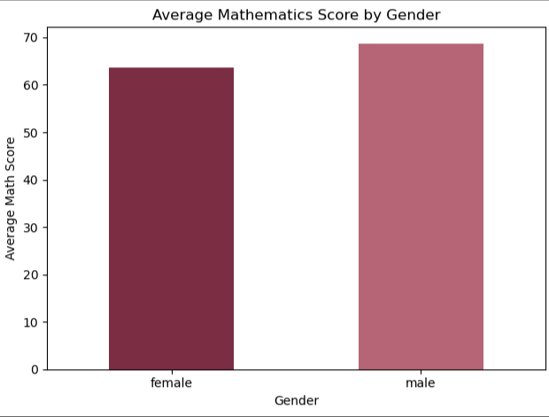
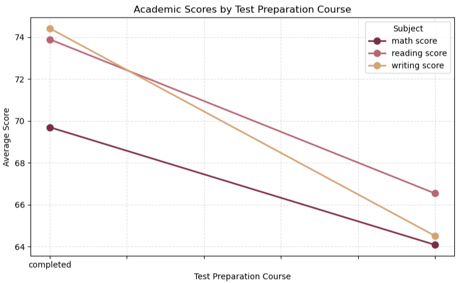
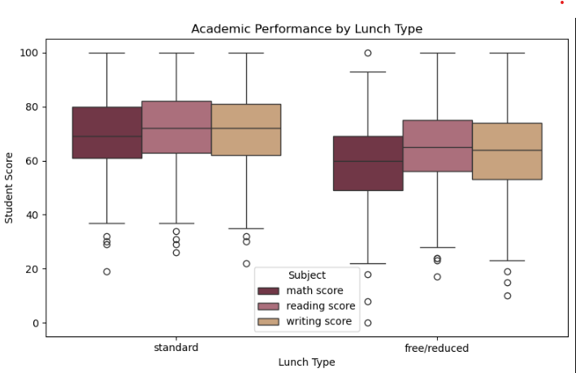
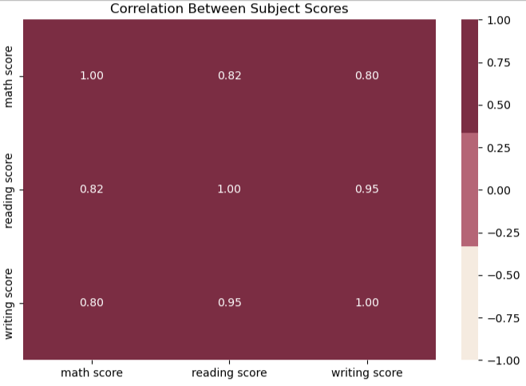
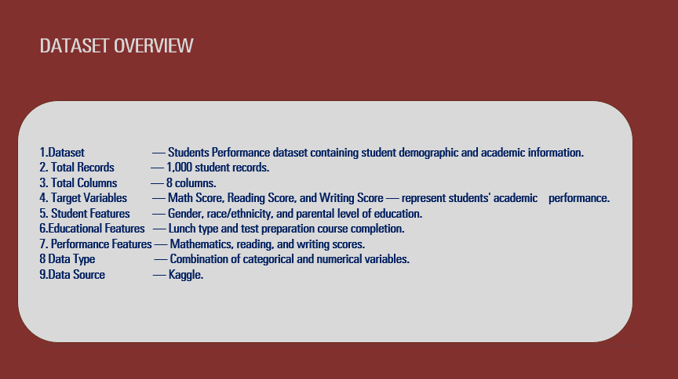
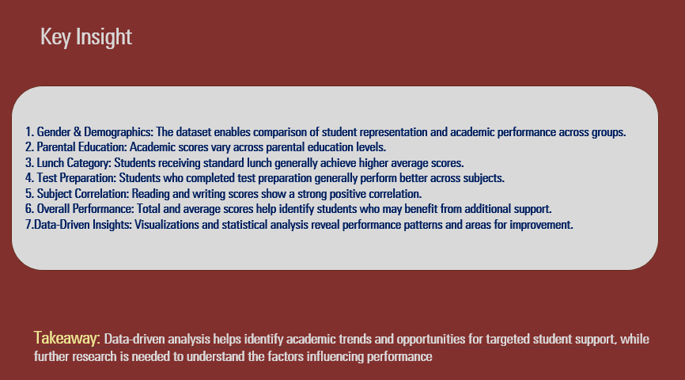

# STUDENTS-PERFORMANCE-ANALYSIS

## Analysis of Student Performance and Academic Achievement

This project analyzes student demographic, socioeconomic, and academic data to understand the factors associated with student performance in mathematics, reading, and writing. Using Python, Pandas, NumPy, Matplotlib, Seaborn, and Jupyter Notebook, the project explores student characteristics, test preparation, lunch categories, and academic scores to generate meaningful educational insights.

## 📌 Project Overview

Understanding the factors associated with academic performance is important for educational institutions, teachers, policymakers, and educators. Student achievement can vary across demographic backgrounds, parental education levels, lunch categories, and test preparation experiences.

This project explores the **Students Performance Dataset**, containing **1,000 student records and 8 columns**. The dataset includes demographic information, parental education, lunch type, test preparation course completion, and scores in mathematics, reading, and writing.

The analysis focuses on understanding academic performance patterns, comparing student groups, and identifying factors associated with differences in examination scores.

Various analytical techniques were applied, including:

- Data Cleaning and Preprocessing
- Exploratory Data Analysis (EDA)
- GroupBy Analysis
- Statistical Analysis
- Correlation Analysis
- Comparative Analysis
- Data Visualization

Python and its data analytics libraries were used to transform the dataset into meaningful insights that can support data-driven educational decision-making.

## 📊 Project Details

| Item | Details |
|---|---|
| **Project Title** | Analysis of Student Performance and Academic Achievement |
| **Dataset** | Students Performance Dataset |
| **Records** | 1,000 |
| **Columns** | 8 |
| **Subjects Analyzed** | Mathematics, Reading, Writing |
| **Project Year** | 2025–2026 |

## 📂 Project Files

The dataset and Jupyter Notebook are included to help users review the analysis process and reproduce the results.

- `StudentsPerformance.csv` – Student performance dataset
- `Students_Performance_Analysis.ipynb` – Data analysis notebook
- `README.md` – Project documentation
- `Students_Performance_Analysis_Presentation.pptx` – Project presentation slides
- `visualizations/` – Selected charts and graphs
- `slide/` – Presentation slide images, including Dataset Overview and Key Findings

*Note: Update the filenames above to match the actual filenames in your GitHub repository.*

## 🛠️ Tools & Technologies

| Tool / Library | Purpose |
|---|---|
| Python | Data cleaning and analysis |
| Pandas | Data manipulation and analysis |
| NumPy | Numerical operations |
| Matplotlib | Data visualization |
| Seaborn | Statistical visualization |
| Jupyter Notebook | Analysis and documentation |

## 🎯 Project Objective

- Analyze student performance across mathematics, reading, and writing.
- Understand the distribution of academic scores.
- Compare academic performance by gender and other demographic categories.
- Examine the relationship between parental education and student scores.
- Analyze performance differences by lunch type.
- Evaluate the association between test preparation and academic achievement.
- Identify patterns that may support educational planning and student support strategies.

## 📊 Data Description

The Students Performance Dataset contains information about student demographics, educational background, and examination scores.

- **Total Records:** 1,000
- **Total Columns:** 8
- **Numerical Variables:** Math Score, Reading Score, Writing Score
- **Categorical Variables:** Gender, Race/Ethnicity, Parental Level of Education, Lunch, Test Preparation Course

### Main Data Categories

| Category | Variables |
|---|---|
| **Student Demographics** | Gender, Race/Ethnicity |
| **Parental Education** | Parental Level of Education |
| **Lunch Category** | Standard, Free/Reduced |
| **Test Preparation** | Completed, None |
| **Academic Performance** | Math Score, Reading Score, Writing Score |

## 🔄 Project Workflow

The project follows a structured data analytics workflow:

Dataset Understanding → Data Cleaning → Exploratory Data Analysis → Statistical Analysis → Data Visualization → Key Insights → Recommendations → Conclusion

## 🚀 Project Phases

### Phase 1: Data Collection & Understanding
- Load the Students Performance Dataset.
- Examine the dataset structure and dimensions.
- Identify numerical and categorical variables.
- Review data types and summary statistics.

### Phase 2: Data Cleaning & Preprocessing
- Check for missing values and duplicate records.
- Verify column names and data types.
- Inspect the consistency of categorical values.
- Prepare the dataset for analysis.

### Phase 3: Exploratory Data Analysis
- Analyze the distribution of mathematics, reading, and writing scores.
- Compare academic performance across demographic groups.
- Examine score differences by parental education level.
- Investigate performance patterns by lunch category and test preparation.

### Phase 4: Statistical Analysis
- Calculate mean, median, standard deviation, minimum, and maximum scores.
- Compare average scores across student groups.
- Examine relationships between the three subject scores.
- Calculate total scores and average academic scores where useful.

### Phase 5: Data Visualization
- Create bar charts, histograms, box plots, and correlation heatmaps.
- Compare mathematics, reading, and writing scores.
- Visualize differences across lunch categories and test preparation groups.
- Present findings using clear and informative charts.

### Phase 6: Key Insights
- Identify patterns in student academic performance.
- Compare subject scores across different groups.
- Examine the association between test preparation and academic scores.
- Investigate the relationship between lunch category and performance.

### Phase 7: Recommendations
- Encourage access to appropriate test preparation resources.
- Identify student groups that may benefit from additional academic support.
- Consider socioeconomic context when interpreting performance differences.
- Use evidence from the analysis to inform educational support strategies.

### Phase 8: Conclusion
- Summarize the main findings.
- Highlight patterns associated with academic achievement.
- Discuss the limitations of the dataset.
- Identify opportunities for further analysis.

## 🔍 Exploratory Data Analysis (EDA)

Exploratory Data Analysis was performed to understand student characteristics, score distributions, and relationships between academic performance and selected categorical variables.

### Key Areas Analyzed

- **Gender Analysis:** Comparison of academic scores by gender.
- **Race/Ethnicity Analysis:** Examination of score patterns across demographic groups.
- **Parental Education Analysis:** Comparison of average scores across parental education levels.
- **Lunch Type Analysis:** Comparison of academic performance between standard and free/reduced lunch groups.
- **Test Preparation Analysis:** Examination of score differences between students who completed a preparation course and those who did not.
- **Subject Score Analysis:** Comparison of mathematics, reading, and writing performance.
- **Total Score Analysis:** Calculation of combined academic scores across the three subjects.
- **Correlation Analysis:** Examination of relationships among mathematics, reading, and writing scores.

### Analysis Techniques

| Analysis | Description | Variables Used |
|---|---|---|
| **Univariate Analysis** | Examines the distribution of one variable. | Gender, Math Score, Reading Score |
| **Bivariate Analysis** | Examines relationships between two variables. | Lunch vs Math Score |
| **Multivariate Analysis** | Examines several variables together. | Lunch, Test Preparation, Subject Scores |
| **GroupBy Analysis** | Calculates summary statistics for different groups. | Gender, Lunch, Test Preparation |
| **Comparative Analysis** | Compares academic scores across categories. | Lunch Type, Parental Education |
| **Statistical Analysis** | Summarizes numerical data. | Math, Reading, Writing Scores |
| **Correlation Analysis** | Measures relationships between numerical variables. | Math, Reading, Writing Scores |
| **Data Visualization** | Presents patterns using charts and graphs. | Subject Scores and Student Categories |

## 🔑 Key Insights

- **Academic Performance:** Mathematics, reading, and writing scores show different distributions across students.
- **Subject Relationships:** Reading and writing scores tend to be positively associated with mathematics and with each other.
- **Test Preparation:** Students who completed the test preparation course generally achieved higher average scores across the three subjects in this dataset.
- **Lunch Type:** Students receiving standard lunch generally recorded higher average scores than students receiving free/reduced lunch.
- **Parental Education:** Academic score patterns vary across parental education categories.
- **Gender Differences:** The relative performance of groups differs by subject.
- **Combined Performance:** Total and average scores help summarize overall performance across the three subjects.

*These findings describe patterns in the dataset. They do not establish that any single demographic or socioeconomic factor directly causes differences in academic achievement.*

### Overall Takeaway

> Understanding student performance requires examining multiple factors, including subject-specific achievement, test preparation, educational background, and socioeconomic context. Data analysis can help identify patterns and opportunities for more targeted academic support.

## 📈 Selected Visualizations

The following visualizations highlight important academic performance patterns.

| Visualization | Purpose |
|---|---|
| **Math Score Distribution** | Shows the distribution of mathematics scores. |
| **Reading Score Distribution** | Shows the distribution of reading scores. |
| **Writing Score Distribution** | Shows the distribution of writing scores. |
| **Average Score by Gender** | Compares average subject scores by gender. |
| **Performance by Test Preparation** | Compares subject scores by test preparation status. |
| **Lunch Type Comparison** | Examines academic score differences by lunch category. |
| **Parental Education Analysis** | Compares performance across parental education levels. |
| **Subject Score Correlation Heatmap** | Displays correlations between mathematics, reading, and writing scores. |
| **Total Score Analysis** | Examines combined scores across the three subjects. |
| **Subject-wise Box Plot** | Shows score distributions, medians, variability, and potential outliers. |

## 🖼️ Visualizations

Add your saved chart images to the `visualizations/` folder and display them using the correct filenames.









*Ensure the image filenames and folder capitalization match your GitHub repository exactly.*

## 📌 Data & Analysis Considerations

- The analysis is based on 1,000 student records.
- Missing values and duplicate records should be checked during preprocessing.
- Group averages summarize observed differences but do not explain every individual student's performance.
- Correlation indicates association and does not establish causation.
- Demographic and socioeconomic variables should be interpreted carefully and without stereotyping students.
- The dataset does not contain every factor that may influence academic achievement.
- Further analysis using additional educational data would help validate and extend the findings.

## 🚀 Future Enhancements

- Build an interactive dashboard using Power BI or Plotly.
- Perform more detailed statistical hypothesis testing.
- Explore relationships among student characteristics and subject scores.
- Develop a student performance prediction model, with appropriate validation.
- Add further visualizations and comparative analysis.
- Explore additional datasets to investigate academic performance patterns.

## 📁 Repository Structure

```text
Students-Performance-Analysis/
├── Students_Performance_Analysis.ipynb
├── StudentsPerformance.csv
├── Students_Performance_Analysis_Presentation.pptx
├── README.md
├── slide/
│   ├── dataset_overview.png
│   └── key_findings.png
└── visualizations/
    ├── math_score_distribution.png
    ├── reading_score_distribution.png
    ├── writing_score_distribution.png
    ├── test_preparation_performance.png
    ├── lunch_type_comparison.png
    └── subject_score_correlation.png
```


## 📊 Project Presentation

The PowerPoint presentation summarizes the Students Performance Analysis project, including the project objectives, dataset description, methodology, exploratory data analysis, visualizations, key findings, and recommendations.


### Presentation Highlights

- Project Overview and Objectives
- Dataset Description
- Data Cleaning and Preprocessing
- Exploratory Data Analysis (EDA)
- Student Academic Performance Analysis
- Lunch Type and Test Preparation Comparison
- Key Findings and Business/Educational Insights
- Recommendations and Conclusion

- ## 📊 Presentation Slides

### Dataset Overview


### Key Findings & Insights



## 👨‍💻 Conclusion


This project demonstrates how Python-based data analytics can be used to explore student academic performance and identify meaningful patterns across mathematics, reading, and writing scores. The findings can help educators better understand group-level differences and identify areas for further investigation.

The project also demonstrates practical skills in data cleaning, exploratory data analysis, statistical analysis, data visualization, and communicating insights through a structured analytical report.

**Tools:** Python | Pandas | NumPy | Matplotlib | Seaborn | Jupyter Notebook

## 👤 Author

# Honey Stanly

 ## 📊 Students Performance Analysis: Exploratory Data Analysis & Academic Insights.


  ## Data Analytics Enthusiast | Customer Support SME | Operations Analyst

